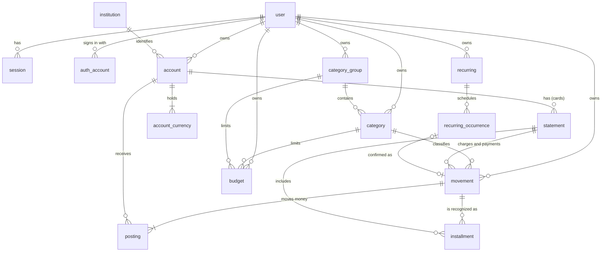

# Data model

The Postgres schema that supports the business decisions in [docs/business](../business/README.md). Technical choices behind it are in [ADR 0016](../adr/0016-data-model.md).

## Diagram

## Conventions

- Primary keys are UUIDs. Every user-owned table has `user_id`.
- References between user-owned tables are **composite foreign keys** `(user_id, id)`, so a row can only point to rows of the same user. The database itself rejects a movement that points to another user's account.
- Money is `bigint` in minor units (cents) with a `currency` column (`ARS` or `USD`). Never floating point.
- Dates of movements are `date` (calendar day in Argentina); audit columns are `timestamptz`.
- Default items (categories, groups) store a translation key in `name_key`; a user-renamed item stores its text in `name`. Exactly one of the two is set.
- Rows referenced by movements are protected with `ON DELETE RESTRICT`; the app offers deactivation (`is_active = false`) instead.
- Balances are calculated from postings and opening balances, not stored.

## Tables

### Authentication (Better Auth)

| Table | Purpose |
| --- | --- |
| `user` | Person signed in with Google. Extra column: `locale` (`es` default, `en`). |
| `session` | Active sessions. |
| `auth_account` | Google OAuth link. Renamed from Better Auth's default `account` to avoid clashing with money accounts. |
| `verification` | Better Auth verification tokens. |

### Categories

**`category_group`**: expense groups (Housing, Utilities...).
`id, user_id, name_key, name, sort_order, created_at`

**`category`**
`id, user_id, type (income | expense), group_id, name_key, name, icon, color (1-5), is_active, sort_order, created_at`
- `group_id` is required for expenses and null for income (check constraint).
- `icon` is a Lucide icon name; null shows the first letter.

### Accounts

**`institution`**: global catalog of banks and wallets, read-only for users, not user-owned.
`id, kind (bank | wallet), name, logo_path`

**`account`**
`id, user_id, type (cash | bank | wallet | credit_card | person), institution_id, name_key, name, closing_day, due_day, is_active, created_at`
- People are accounts of type `person`: a positive balance means they owe the user.
- `closing_day` and `due_day` apply only to credit cards.

**`account_currency`**: currencies an account holds, with its starting balance.
`account_id, user_id, currency, opening_balance_minor` (primary key: `account_id, currency`)

### Movements

**`movement`**: what the user recorded.
`id, user_id, type (income | expense | transfer), occurred_on, description, category_id, statement_id, recurring_occurrence_id, created_at, updated_at`
- `category_id` is required for income and expense, null for transfers.
- `statement_id` is set for card charges (forced into a statement) and for statement payments.

**`posting`**: how the movement changes account balances. Signed amounts.
`id, user_id, movement_id, account_id, currency, amount_minor`

| Case | Postings |
| --- | --- |
| Cash expense $ 48.300 | Cash −48.300 |
| Income $ 1.250.000 | Galicia +1.250.000 |
| Transfer bank to cash | Galicia −X, Cash +X |
| Buy US$ 1.000 at $ 1.230 | Galicia ARS −1.230.000, Galicia USD +1.000 |
| Card purchase $ 900.000 | Visa −900.000 |
| Shared purchase, half for Juan | Visa −80.000, Juan +40.000 |
| Lend Juan US$ 500 | Cash USD −500, Juan USD +500 |
| Pay statement | Galicia −X, Visa +X |

**`installment`**: when and how much of an income or expense counts, and in which statement. Every income and expense has at least one.
`id, user_id, movement_id, number, period_month, statement_id, currency, amount_minor, own_amount_minor`
- `period_month` is the month the installment counts in: the statement closing month for cards, the movement month otherwise.
- `own_amount_minor` is the user's share; `amount_minor − own_amount_minor` is owed by the person in a purchase for others.
- Reports, "In", "Out" and budgets read installments, never postings.

### Credit card statements

**`statement`**
`id, user_id, account_id, period_month, closing_date, due_date, minimum_ars_minor, minimum_usd_minor, bank_total_ars_minor, bank_total_usd_minor`
- Created from the card's usual days; the user can correct `closing_date` and `due_date`, and installments of that period are reassigned.
- Previous balance, totals and the difference with the bank are calculated.

### Recurring movements

**`recurring`**
`id, user_id, type, frequency (monthly | bimonthly | yearly), day_of_month, month_of_year, amount_mode (fixed | variable), amount_minor, currency, account_id, category_id, description, starts_on, ends_on, is_paused`

**`recurring_occurrence`**: one row per due date, created when it becomes due.
`id, user_id, recurring_id, due_on, status (pending | confirmed | skipped), movement_id`
- Unique per `recurring_id, due_on`, so generating occurrences is idempotent.

### Budgets

**`budget`**
`id, user_id, category_id, group_id, currency, limit_minor, created_at`
- Exactly one of `category_id` or `group_id` is set.

## Indexes

- `posting (user_id, account_id, currency)` for balances.
- `installment (user_id, period_month)` for monthly totals and reports.
- `installment (user_id, statement_id)` for statements.
- `movement (user_id, occurred_on desc)` for the movements list.
- Trigram index on `movement.description` for search.
